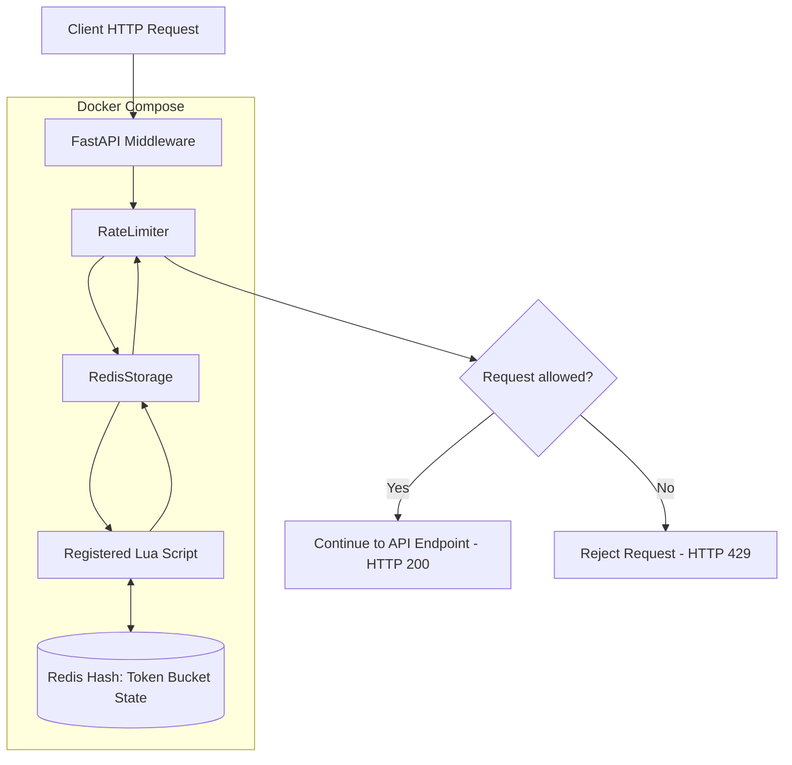

# distributed-rate-limiter

# Distributed Rate Limiter

A distributed rate limiter built with **Python, FastAPI, Redis, and Lua**. It implements the Token Bucket algorithm to control incoming API requests based on client IP addresses, with atomic token operations and automatic expiration of inactive rate-limit buckets.

## Features

- **Token Bucket algorithm** – controls request rates using token capacity and refill rates.
- **Distributed storage** – Redis stores rate-limit state, allowing multiple API instances to share the same limits.
- **Atomic operations** – Lua scripts execute token checks, refills, and updates atomically within Redis.
- **Automatic expiration** – inactive rate-limit buckets expire through Redis TTL.
- **Concurrency support** – Redis-backed state prevents concurrent requests from bypassing token consumption.
- **Containerisation** – FastAPI and Redis run using Docker Compose.
- **Performance benchmarking** – measures throughput, average latency, P95 and P99 latency under concurrent workloads.

## Architecture

The application separates rate-limiting logic from storage, allowing different storage backends to be used without changing the rate limiter itself.



### Components

| Component | Responsibility |
|---|---|
| `main.py` | FastAPI application and rate-limiting middleware |
| `limiter.py` | Token Bucket algorithm implementation |
| `rateLimiter.py` | Rate limiter abstraction |
| `storage.py` | Original in-memory storage backend |
| `redis_storage.py` | Redis-backed storage implementation |
| `redis_client.py` | Redis connection configuration |
| `scripts/token_bucket.lua` | Atomic token bucket operations |

## How It Works

The application uses the **Token Bucket algorithm**.

Each client IP address is assigned a bucket containing a limited number of tokens.

- Every incoming request consumes one token.
- Tokens are replenished over time at a configured refill rate.
- Requests are accepted when at least one token is available.
- Requests are rejected when the bucket has insufficient tokens.

### Configuration

The current implementation uses:

| Parameter | Value |
|---|---:|
| Bucket capacity | 2 tokens |
| Initial tokens | 2 |
| Refill rate | 10 tokens/minute |
| Redis TTL | 1,800 seconds |

### Redis and Lua Atomicity

Rate-limit state is stored in Redis hashes, with a separate key for each client IP address.

A Lua script performs the following operations:

1. Retrieves the current Redis server time.
2. Checks whether the client's bucket exists.
3. Creates a new bucket when necessary.
4. Calculates elapsed time and replenishes tokens.
5. Determines whether the request can be accepted.
6. Updates the token count and timestamp.
7. Refreshes the bucket's expiration time.

Executing these operations inside a single Lua script ensures that the token check and update happen atomically. Concurrent requests cannot interleave their token operations and consume the same token.

Redis TTL is refreshed whenever a request is processed, allowing inactive buckets to expire automatically.

## Technology Stack

- **Python** – application logic.
- **FastAPI** – HTTP API and middleware.
- **Redis** – shared rate-limit state.
- **Lua** – atomic Redis operations.
- **Docker** – application containerisation.
- **Docker Compose** – multi-container orchestration.
- **pytest** – automated testing.
- **ThreadPoolExecutor** – concurrent workload generation.

## Getting Started

### Prerequisites

- Python 3.12 or newer.
- Docker and Docker Compose.
- Git.

### 1. Clone the repository

```bash
git clone https://github.com/Fabi2708/distributed-rate-limiter.git
cd distributed-rate-limiter
```

### 2. Configure environment variables

Create a local environment file:

```bash
cp .env.example .env
```

The example configuration:

```env
REDIS_HOST=localhost
REDIS_PORT=6379
```

### 3. Start the application

Build and start the containers:

```bash
docker compose up --build
```

Docker Compose starts Redis and the FastAPI application. The API waits for Redis to pass its health check before starting.

The API is available at:

```text
http://localhost:8000
```

### 4. Test the API

Send requests using curl:

```bash
curl http://localhost:8000/
```

The first two requests from a new client IP are accepted. Subsequent requests are rejected until tokens are replenished.

Example responses:

**Accepted request — HTTP 200**

```json
{
  "message": "Rate Limiter API"
}
```

**Rejected request — HTTP 429**

```json
{
  "detail": "Too many requests!"
}
```

### 5. Stop the application

```bash
docker compose down
```

Redis uses a named Docker volume for data persistence. To remove the containers and the persistent Redis volume:

```bash
docker compose down -v
```

**Warning:** The `-v` option deletes the stored Redis volume and its data.

## Testing

Automated tests are implemented using pytest.

Run the test suite:

```bash
python -m pytest -v
```

The tests cover:

- API request acceptance and rejection.
- Redis-backed token bucket behaviour.
- Concurrent requests.
- Token replenishment.
- Redis TTL expiration.

The tests require a running Redis instance. The current test fixture uses `FLUSHDB` to reset Redis state, so tests should only be run against a dedicated test Redis database or instance.

## Performance Benchmarking

The application was evaluated using concurrent workloads against Redis.

### Methodology

The rate limiter benchmark uses:

- 100 unique client IP addresses.
- 10 requests per IP address.
- 1,000 total requests per run.
- Bucket capacity of 2 tokens per client.
- Four repetitions for each worker configuration.

The expected result is 200 accepted requests and 800 rejected requests, assuming negligible token replenishment during the workload.

The benchmark measures:

- **Throughput:** completed requests per second.
- **Average service time:** time spent inside the Redis-backed rate-limiting operation.
- **Average latency:** time from task submission to completion.
- **P95 and P99 latency:** latency experienced by the slower requests.

### Rate Limiter Results

Average results across four runs:

| Worker Threads | Throughput (req/s) | Average Latency (ms) |
|---:|---:|---:|
| 1 | 7,580 | 66.015 |
| 2 | 12,047 | 43.563 |
| 5 | 7,299 | 65.780 |
| 10 | 7,103 | 64.581 |

The highest measured throughput occurred with two worker threads, reaching approximately **12,047 requests per second**.

Increasing concurrency beyond two workers did not improve throughput in this test environment.

### Redis PING Comparison

A separate benchmark measured Redis PING operations using the same Python Redis client and thread-pool approach.

| Worker Threads | PING Throughput (req/s) |
|---:|---:|
| 1 | 8,489 |
| 2 | 14,326 |
| 5 | 7,175 |
| 10 | 7,135 |

The PING benchmark exhibited a similar performance pattern to the rate limiter benchmark. This suggests that the observed degradation at higher concurrency is not exclusive to the Lua rate-limiting implementation.

Further investigation would be required to isolate the exact cause, which may involve Python thread scheduling, Redis connection handling, or the Docker/WSL networking environment.

**Benchmark limitations:** These measurements represent a local development environment, not production infrastructure. Results may vary with hardware, container configuration, network conditions, and workload characteristics. They should not be interpreted as production capacity guarantees.

## Project Structure

```text
distributed-rate-limiter/
│
├── app/
│   ├── scripts/
│   │   └── token_bucket.lua
│   ├── main.py
│   ├── limiter.py
│   ├── rateLimiter.py
│   ├── redis_client.py
│   ├── redis_storage.py
│   └── storage.py
│
├── tests/
│   ├── conftest.py
│   ├── test_api.py
│   ├── test_redis_storage.py
│   ├── test_ttl.py
│   ├── test_benchmark.py
│   └── test_ping_benchmark.py
│
├── .dockerignore
├── .env.example
├── .gitignore
├── Dockerfile
├── docker-compose.yml
└── requirements.txt
```

## Future Improvements

- Support configurable bucket capacity and refill rates.
- Add configurable rate-limiting strategies.
- Improve benchmark isolation and repeatability.
- Add monitoring and metrics collection.
- Add authentication and API key-based rate limiting.
- Evaluate performance under larger workloads and multiple API instances.
